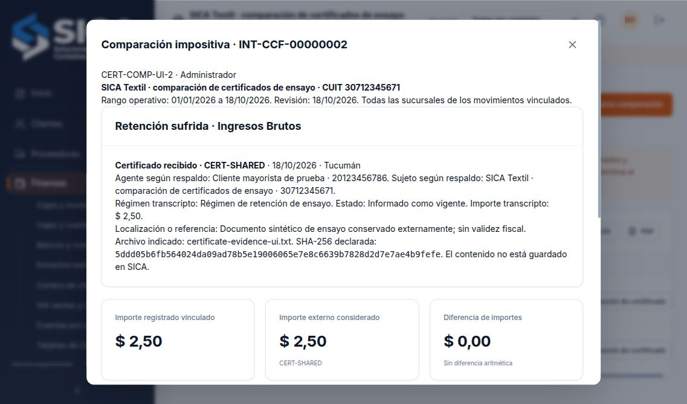

# Comparación manual de certificados impositivos

Ruta: Finanzas → Comparación de certificados (`/finanzas/conciliacion-certificados`). Conserva revisiones INT-CCF de un certificado recibido, una consulta de organismo o un documento que incluya percepción, contra los movimientos registrados. Es una comparación con datos transcritos por el operador, sin conexión ni constatación del organismo emisor.

## Respaldo y vínculos

Se registran tipo y sentido, impuesto, jurisdicción, número, fecha, régimen, CUIT y nombres del agente/sujeto, importe transcripto, estado declarado y localización del respaldo. En las comparaciones ordinarias los CUIT deben ser válidos y distintos. La empresa debe ser el sujeto de una retención/percepción sufrida o el agente de una practicada. IIBB exige jurisdicción. No se presume condición de agente ni cómputo por elegir una forma jurídica, provincia o régimen.

El rango operativo debe estar cubierto por los ejercicios conservados; puede cruzar ejercicios contiguos. La fecha de revisión no puede preceder al rango ni al respaldo y no puede ser futura. Una fecha de respaldo fuera del rango queda señalada para revisar su relación: el rango operativo no determina el período fiscal de cómputo.

Se eligen hasta cien movimientos distintos del mismo concepto, sentido e impuesto, con jurisdicción coincidente o pendiente de identificar. Las percepciones de internos X requieren regularizar su origen antes de este circuito. Es posible conservar un respaldo sin vínculos para mostrar la falta de correspondencia.

Los importes de notas de crédito conservan su signo. Los CUIT, referencias de retención y datos de identificación faltantes o diferentes requieren fundamento del vínculo y mantienen «Identificación pendiente», aunque la diferencia sea cero. En percepciones la referencia registrada puede ser un régimen y no se interpreta automáticamente como número de certificado.

La diferencia es movimiento vinculado menos importe externo considerado. Si el respaldo se declara anulado, el importe considerado es cero, se conserva el valor transcripto y el estado siempre exige revisión. No se revierten asientos ni se anula un certificado oficial mediante esta selección.

## Versiones y controles

Cada revisión exige referencia única, fundamento, confirmación del operador y el contenido exacto preparado. Una corrección parte de la última versión de su cadena. Se conservan todas las anteriores, sus responsables, vínculos, importes y contexto. El mismo respaldo identificado no inicia una segunda cadena, y un movimiento no puede respaldar dos cadenas vigentes. Si una versión deja de vincular movimientos, la constancia conserva la liberación y el fundamento; las operaciones originales permanecen intactas.

En retenciones, otros movimientos del rango con la misma referencia y contraparte conservada se señalan si quedaron sin vincular. Una diferencia cero no resuelve esa señal. El sistema no descarta importes repetidos automáticamente: puede tratarse de un certificado distribuido.

La revisión conserva datos transcritos y el contexto de catálogo utilizado: empresa, nombres, CUIT, sucursales y fuentes relevantes. Los cambios posteriores no reescriben el detalle histórico. La pantalla indica fuentes cambiadas y permite preparar una versión nueva. La restauración reproduce las revisiones desde sus fuentes conservadas y rechaza alteraciones incoherentes de importes, vínculos, antecedentes o secuencias.

## Archivo y exportación

Opcionalmente, el navegador calcula SHA-256 de un archivo de hasta 20 MB y conserva su nombre y huella declarada. El contenido del archivo no se guarda ni se incluye en la copia de SICA: debe conservarse el original en la ubicación indicada. La huella no acredita autenticidad ni validación oficial. El cálculo usa el archivo elegido; una selección posterior sustituye la anterior y las operaciones en curso no deben mezclar nombre y huella.

Cada constancia exporta un JSON con datos del respaldo, movimientos, identificación, diferencias, versión, responsable y alcance. Es un papel de comparación; no es un certificado oficial, declaración ni archivo de importación a un organismo. Las tablas ofrecen las exportaciones operativas habituales.

## Permisos y fuentes

El permiso de comparación permite revisar y conservar estas constancias y recibe los renglones impositivos necesarios. No concede por sí mismo comprobantes completos, asientos, datos bancarios, escritura de operaciones o respaldo completo. El servidor calcula la preparación con sus propias fuentes; no confía en renglones suministrados por el navegador. El permiso exclusivo del [reporte de retenciones/percepciones](retenciones-percepciones-registradas.md) conserva su lectura de renglones y no puede preparar, guardar ni consultar estos respaldos declarados.

Para los regímenes de su competencia, ARCA describe los datos disponibles en [Mis Retenciones](https://www.arca.gob.ar/genericos/retenciones.asp) y la generación de certificados en [SIRE](https://arca.gob.ar/sire/percepciones-retenciones/certificados.asp). Esos servicios tienen su alcance propio. SICA no los consultó ni emitió certificados en este ensayo; la revisión provincial de IIBB sigue siendo específica de la jurisdicción.

## Alcance pendiente

Continúan pendientes conexión o importación de información oficial, archivo íntegro de documentos en el servidor, constatación de autenticidad y vigencia, correcciones documentadas de identidad histórica, regímenes excepcionales, multimoneda, cómputo fiscal y declaraciones. La comparación manual no acredita cumplimiento normativo integral. La [matriz del PPTX](requisitos-y-alcance.md) conserva los demás pendientes del objetivo.

## Verificación del 18/10/2026

En la base sintética `var/qa-tax-certificates.sqlite`, el navegador conservó INT-CCF-00000001 con un movimiento de $1 frente a un respaldo de $2,50: diferencia −$1,50 y otro movimiento con referencia compartida sin vincular. La nueva versión INT-CCF-00000002 incorporó el segundo movimiento de $1,50: diferencia cero y ninguna referencia restante. La primera constancia quedó idéntica a la capturada antes de corregir. Tras recargar, ambas siguieron disponibles en revisión 3. Se conservó en las dos la huella calculada desde `certificate-evidence-ui.txt`, contrastada independientemente con SHA-256. Son documentos de ensayo sin validez fiscal.

Permanecieron idénticos los doce documentos, trece asientos, dos movimientos de stock, una liquidación de tarjeta y el resto del estado previo. No se creó trabajo fiscal ni se contactó un organismo. Las exportaciones JSON reproducen exactamente las revisiones guardadas. Se verificaron sus bytes; el evento de descarga del navegador y las exportaciones XLSX/PDF de estas tablas no se consideran verificados.

Pasaron **587 pruebas de dominio, 84 HTTP, 32 fiscales y 36 de archivos: 739**, sin fallos, además de lint y compilaciones compartida/servidor. Incluyen permisos y redacción de datos, fuentes autoritativas, CSRF, idempotencia y concurrencia, vínculos reutilizados, referencias únicas, fuentes conservadas, importes negativos, respaldos anulados, fechas, rangos entre ejercicios contiguos, identidades incompletas, huellas y restauración incoherente.

Las **60 bases** conservaron validación completa después de JSON, integridad SQLite, auditoría HMAC, fuentes fiscales y lectura de renglones impositivos. Un respaldo sellado se recuperó de revisión 3 a 4 con estado y credenciales idénticos, las dos comparaciones, once renglones impositivos y ambos JSON idénticos en bytes. Se revocó una sesión y quedaron cero sesiones en la recuperación; se retiró la copia temporal.

Informe: [verification-tax-certificates-2026-10-18.json](../output/verification-tax-certificates-2026-10-18.json). Recorrido reproducible: `scripts/preview-tax-certificates-ui.mjs`, guardado de dos versiones desde la interfaz y `scripts/verify-tax-certificates-ui.mjs`, con Node 24 y servidor previamente compilado. El verificador requiere los archivos de evidencia de este ensayo y no crea las comparaciones por API.

Desde el 18/10/2026, las nuevas operaciones [conservan identidad impositiva en el origen](identidad-impositiva.md). Los movimientos vinculados indican esa procedencia o la ausencia de identidad histórica, y los pendientes conservados se trasladan a la comparación. Los datos incompletos y los CUIT de empresa que difieren entre origen y revisión mantienen identificación pendiente.
