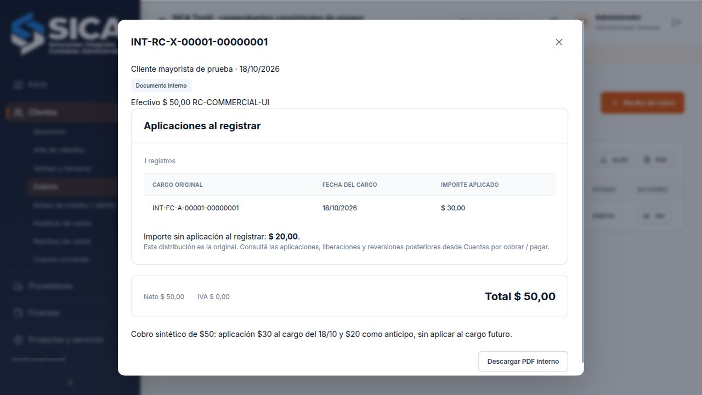

# Consistencia de comprobantes y aplicaciones

Los controles compartidos por modo local y servidor protegen la relación entre cliente/proveedor, comprobante, medios de pago y cargos aplicados. Cubren los circuitos de las diapositivas 40–64 y 79 del PPTX; no sustituyen la validación fiscal de un comprobante.

## Sentido y contenido

- Los cobros y pedidos corresponden a clientes; los pagos y órdenes de compra, a proveedores. La contraparte conservada debe pertenecer a esa cuenta. La ruta de autorización se calcula después de verificar esa combinación.
- Un cobro o pago conserva sus medios y no admite líneas de artículos o servicios. Su total debe coincidir con la suma de importes de esos medios, con IVA y percepciones en cero.
- Facturas, notas, pedidos, remitos y saldos iniciales no admiten medios de pago adjuntos. Para cancelar una deuda debe registrarse el cobro o pago correspondiente.
- Cobros, pagos, notas de crédito y saldos iniciales negativos admiten aplicaciones originales sobre cargos, dentro de su importe. Los créditos sin aplicar pueden vincularse posteriormente mediante el circuito INT-AC.
- Las cantidades son positivas, los precios e importes se expresan en centavos enteros seguros, los descuentos se mantienen entre 0 y 100 y las alícuotas deben estar reconocidas. Los totales conservados se contrastan con líneas, IVA y percepciones.
- Las fechas y vencimientos deben ser fechas calendario válidas; un vencimiento declarado no puede preceder a la fecha del comprobante. El período abierto sigue siendo controlado por sus reglas contables específicas.

Las comisiones y débitos internos por rechazo de cheque conservan sus circuitos propios, sin líneas comerciales. Su recuperación exige una comisión o cheque relacionado que explique su tipo, contraparte, importe y sucursal; no alcanza con agregar la marca de documento interno a una factura cualquiera.

## Origen y cronología

Una factura vinculada debe provenir de un remito; un remito, de pedido de cliente u orden de compra de proveedor; una nota vinculada, de factura. El origen debe corresponder a la misma contraparte, cuenta y sucursal. Las notas fiscales requieren una factura asociada y conservan su clase. La factura vinculada conserva productos y cantidades del remito, incluso al recuperar una copia. Las notas y remitos no pueden preceder a su origen.

Se permite una factura recibida cuya fecha de emisión sea anterior a la recepción de mercadería: el control de cronología de notas/remitos no debe impedir esa situación. El registro contable y de costos posterior a cortes conserva su circuito existente y no se sustituye por esta validación.

## Aplicaciones y anticipos

El destino debe ser una factura, débito o saldo positivo de la misma contraparte, cuenta y sucursal. No se puede aplicar contra un saldo inicial negativo, un documento de otro tipo ni un cargo posterior a la fecha del crédito/cobro/pago. El importe nuevo debe ser positivo y entero en centavos, sin destinos repetidos ni excesos respecto del crédito o del cargo disponible.

Si se recibe dinero antes del cargo, se conserva sin aplicar como anticipo. Después puede vincularse desde [Cuentas por cobrar / pagar](aplicaciones-creditos.md), con revisión y fecha apropiadas. La pantalla muestra la fecha de cada cargo y deshabilita la aplicación a cargos posteriores. Si el operador retrocede la fecha después de haber asignado un importe, mantiene visible la aplicación y ofrece quitarla; no guarda mientras permanezca ese conflicto.

La nota de crédito sobre una factura ya cancelada conserva crédito sin aplicar y no crea una aplicación artificial de importe cero. El detalle de cobros, pagos y notas muestra los cargos originales, sus fechas e importes y el saldo sin aplicar al registrar, distinguiéndolo de redistribuciones posteriores. Cuatro aplicaciones cero de bases históricas de ensayo se conservaron sin cambios ni efecto monetario. Las aplicaciones posteriores, liberaciones y reversiones INT-AC siguen integrándose al disponible; no se presupone que la suma bruta de aplicaciones originales sea el disponible actual.

## Medios normalizados

Se conservan sólo los datos de carga que corresponden al medio elegido. Un efectivo no conserva identificadores adjuntos de cheque/tarjeta ni campos de retención. La retención conserva impuesto y jurisdicción; el cheque, su identificador; el cupón de cobro, su tarjeta y vencimiento calculado por SICA. La cuenta bancaria de una liquidación de tarjeta se reconoce en su propio circuito, sin atribuir al cupón una acreditación en caja.

El total enviado por un cliente no sustituye al total calculado. Los responsables de comandos compartidos provienen de la sesión. La [identidad impositiva](identidad-impositiva.md) conserva su procedimiento autoritativo y no se acepta como historia una identidad inyectada desde el navegador.

## Recuperación y límites

La validación de copias comprueba sentido, contenido, relaciones, fechas y totales, además de las validaciones de contabilidad y fiscalidad existentes. Conserva las aplicaciones históricas cero sin reescribirlas. Se comprueba el límite del cargo considerando también las aplicaciones y liberaciones posteriores, para no invalidar una reasignación legítima.

Estos controles no acreditan autorización fiscal, autenticidad del documento externo, existencia de una contraparte o correcto encuadre normativo de la operación. Tampoco introducen facturación anticipada especial, anulaciones fiscales, compensación entre cuentas distintas ni reapertura de períodos. Los restantes pendientes están en la [matriz del PPTX](requisitos-y-alcance.md).

## Verificación del 18/10/2026

Se reprodujeron sin persistencia cinco cargas que la versión previa aceptaba indebidamente: cobro de proveedor, pago de cliente, factura con aplicaciones, aplicación anterior al cargo y pedido de proveedor. Se verificaron el rechazo de esos casos y de campos/importes inválidos antes de modificar comprobantes, caja o asientos. La autorización específica de cobros no permite registrar pagos ni viceversa. El total y responsable enviados desde el cliente no sustituyen al cálculo y la sesión.

En `var/qa-document-rules.sqlite`, el navegador mostró deshabilitado un cargo del 20/10 al registrar un cobro el 18/10. Al retroceder al 17/10 después de aplicar $30 al cargo del 18/10, el guardado se bloqueó y se ofreció quitar expresamente esa aplicación. Después se restableció el 18/10 y se guardó un cobro de $50, con $30 aplicados y $20 sin aplicar. Tras reiniciar y recargar se recuperó su distribución original, sin sección vacía de artículos. Se conservaron las tres facturas y sus tres asientos, los dos movimientos de stock y el resto del estado previo. Sólo se agregaron recibo, asiento y entrada interna de caja de $50.

La antigüedad al 18/10 concilió pendiente $91 menos crédito libre $20 = saldo $71. Al 20/10 incorporó el cargo futuro de $60,50: pendiente $151,50 menos crédito libre $20 = saldo $131,50. Ese cargo quedó sin aplicación. La recuperación independiente del respaldo sellado pasó de revisión 2 a 3 con estado y credenciales idénticos, el recibo y ambos cortes preservados, una sesión revocada y cero sesiones recuperadas. La copia temporal se retiró.

Pasaron **600 pruebas de dominio, 86 HTTP, 32 fiscales y 36 de archivos: 754**, sin fallos en las ejecuciones confirmadas, lint y compilaciones compartida/servidor. Las HTTP se ejecutaron en dos secciones de 60 y 26 casos, cuya selección se contrastó con los 86 títulos distintos del script completo, sin omisiones ni duplicados. Tras los controles finales sobre nota asociada, cantidades de remito y saldos iniciales negativos, pasaron nuevamente dominio completo y cuatro circuitos HTTP focalizados. Las pruebas fiscales usan servicios simulados.

La ejecución HTTP monolítica interrumpida y el diagnóstico previo se conservaron por separado y no se computan como aprobados. El diagnóstico mostró que el total incoherente se rechaza ahora con 400 antes del control de fuente fiscal; se verifican ambos casos: ese rechazo y el 409 de una modificación monetariamente coherente sobre una fuente fiscal protegida, sin cambiar su estado. También se corrigió un escenario de prueba de servicios mixtos que agregaba una línea al remito sin actualizar sus totales.

Las **62 bases** conservaron validación completa después de JSON, relaciones comerciales, integridad SQLite, auditoría HMAC y fuentes fiscales. Permanecen cuatro aplicaciones antiguas de importe cero, sin modificación. Informe: [verification-document-rules-2026-10-18.json](../output/verification-document-rules-2026-10-18.json). Recorrido: `scripts/preview-document-rules-ui.mjs`, guardado desde la interfaz y `scripts/verify-document-rules-ui.mjs`, con Node 24 y servidor compilado. Las secciones HTTP pueden repetirse con `scripts/test-server-section.mjs core` y `extended`. No se verificaron eventos de descarga ni exportaciones de estas tablas desde el navegador.

