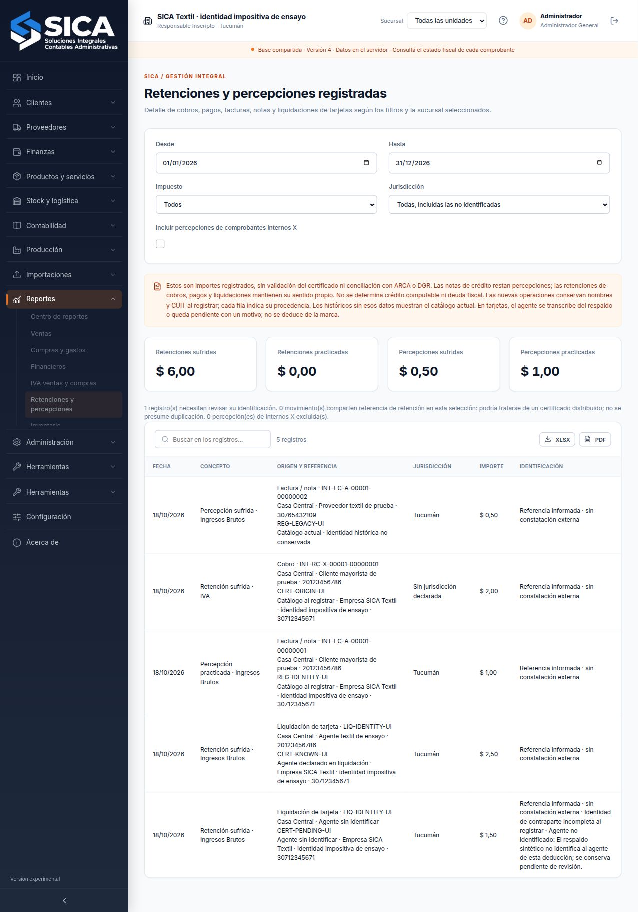

# Identidad impositiva conservada en el origen

Las nuevas retenciones de cobros/pagos y percepciones de facturas/notas conservan nombres y CUIT de la empresa y su contraparte al registrar la operación. Se toman del catálogo que usa el servidor, sin aceptar una identidad histórica enviada por el navegador. Los cambios posteriores de nombre o CUIT no reescriben esos datos.

## Liquidaciones de tarjetas

Cada retención requiere transcribir nombre y CUIT del agente según su certificado. Se normaliza el CUIT y se comprueba el dígito verificador. Puede haber agentes distintos dentro de una liquidación. La marca de tarjeta permanece como origen operativo; no se interpreta como razón social ni CUIT del agente.

Si el respaldo no permite identificarlo, debe elegirse «Agente sin identificar» y explicar el motivo. La retención se registra con su importe y certificado, conservando la identificación pendiente. No se inventa un agente, se deduce de la marca ni se considera que un importe coincidente resuelva esa falta. Un agente identificado y un motivo de desconocimiento no pueden coexistir. Los campos transitorios de carga se sustituyen por la identidad normalizada conservada.

La identidad de la empresa se guarda incluso si su catálogo está incompleto. En ese caso el reporte señala el pendiente; el guardado de un cobro no convierte datos incompletos en datos fiscales válidos.

## Reporte y comparación de certificados

El [reporte impositivo](retenciones-percepciones-registradas.md) muestra la procedencia de identidad de cada fila: catálogo al registrar, agente declarado en liquidación o agente sin identificar. Los registros anteriores sin esta información mantienen su comportamiento de consulta y muestran «Catálogo actual · identidad histórica no conservada». No se les asigna retroactivamente una identidad histórica a partir del catálogo presente.

Las retenciones nuevas con igual referencia se agrupan para su señal de revisión según la identidad fiscal conservada de empresa/contraparte. Dos agentes distintos no comparten esa señal sólo por usar la misma marca y número. Los históricos conservan su criterio anterior. No se descartan movimientos ni se deducen duplicados.

La [comparación INT-CCF](comparacion-certificados-impositivos.md) recibe la identidad del origen y sus pendientes. Si el CUIT de empresa conservado difiere del CUIT actual que se transcribe en el respaldo, requiere fundamento del vínculo y mantiene «Identificación pendiente» incluso con diferencia cero. Las comparaciones anteriores sin este dato mantienen su contexto original y pueden recuperarse sin reescritura.

El detalle del comprobante muestra la identidad impositiva conservada. El detalle de la liquidación incluye agente, CUIT y procedencia por retención. Los documentos internos de comisión o rechazo de cheque no heredan la identidad impositiva de los comprobantes que les dieron origen.

## Permisos y recuperación

El perfil autorizado sólo al reporte recibe los renglones necesarios, incluidos identidad conservada y motivo de agente pendiente. No recibe comprobantes completos, asientos, bancos ni liquidaciones completas. Las proyecciones de documentos para stock y otros circuitos que no autorizan el comprobante completo eliminan esta identidad adicional.

La validación de copias comprueba versión, estructura, procedencia, normalización, ubicación en comprobante/liquidación y coherencia entre agente identificado y motivo pendiente. No se compara la identidad histórica con el catálogo actual para sobrescribirla. Una copia antigua sin esos campos sigue siendo válida. Los sellos del respaldo y la auditoría conservan su alcance propio; una identidad declarada no prueba autenticidad del certificado.

## Alcance

ARCA incluye nombre y CUIT del agente entre los datos consultables en [Mis Retenciones](https://www.arca.gob.ar/genericos/retenciones.asp), fuente consultada el 18/10/2026. Esta ampliación conserva datos operativos declarados en SICA. No consulta ese servicio, verifica inscripciones, valida autenticidad o condición de agente, emite certificados, determina el cómputo ni presenta declaraciones. La normativa y los procedimientos provinciales siguen requiriendo su definición específica. Los demás requisitos siguen en la [matriz del PPTX](requisitos-y-alcance.md).

## Verificación del 18/10/2026

El navegador, sobre `var/qa-tax-identity.sqlite`, rechazó el CUIT inválido sin cambiar la revisión 1 ni ningún dato. Después conservó una liquidación de $100 bruto, $1 de cargos, $4 de retenciones y $95 neto: certificado identificado por $2,50 y otro por $1,50 con motivo pendiente. Se guardaron nombre/CUIT normalizados del agente, identidad de la empresa y motivo; no permanecieron campos de carga ni identidad suministrada como si fuera histórica.

Se cambiaron desde la interfaz nombre y CUIT del cliente, y el nombre de la marca de tarjeta. La revisión 4 recuperada conservó nombre/CUIT originales en la retención y percepción nuevas, el agente de la liquidación y su pendiente. El histórico sin identidad mantuvo su etiqueta explícita. El reporte mostró cinco filas: retenciones sufridas $6, percepciones sufridas $0,50 y practicadas $1. La comparación en memoria de la retención identificada obtuvo cero sin pendientes; la no identificada obtuvo cero con «Identificación pendiente». No se guardaron comparaciones adicionales para ese contraste.

Permanecieron idénticos los cuatro documentos, cuatro asientos previos y dos movimientos de stock. Sólo se agregaron el asiento y movimiento bancario internos de la liquidación; los cambios administrativos se limitaron al nombre/CUIT del cliente y nombre de marca. Un respaldo sellado se recuperó de revisión 4 a 5 con estado y credenciales idénticos, cinco filas, agente y motivo conservados. Se revocó una sesión y quedaron cero; la copia temporal se retiró.

Pasaron **593 pruebas de dominio, 85 HTTP, 32 fiscales y 36 de archivos: 746**, sin fallos, además de lint y compilaciones. Tras los últimos ajustes de validación del motivo, agrupación por identidad y texto de alcance, pasaron nuevamente dominio completo y los tres circuitos HTTP impositivos focalizados. Las **61 bases** conservaron validación completa después de JSON, integridad SQLite, auditoría HMAC, fuentes fiscales y lectura del reporte, incluidas las comparaciones históricas INT-CCF.

Informe: [verification-tax-identity-2026-10-18.json](../output/verification-tax-identity-2026-10-18.json). El recorrido reproducible usa `scripts/preview-tax-identity-ui.mjs`, el guardado y cambios de catálogo desde la interfaz y `scripts/verify-tax-identity-ui.mjs`, con Node 24 y servidor compilado. Las pruebas fiscales son simuladas. No se verificaron eventos de descarga ni exportaciones de estas tablas desde el navegador.

